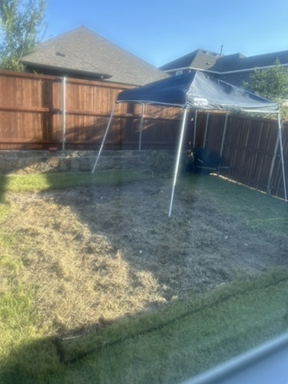
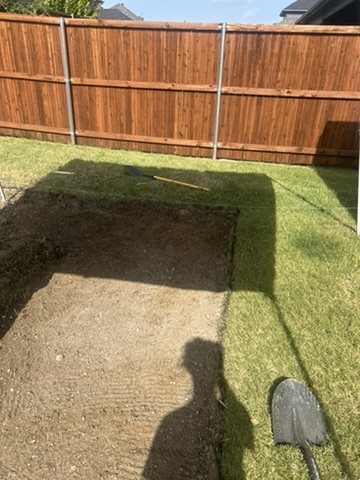
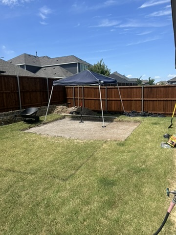
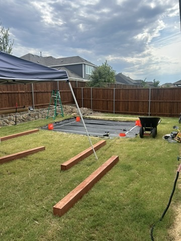
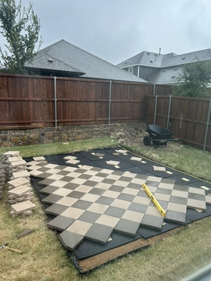
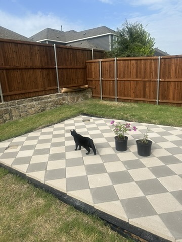
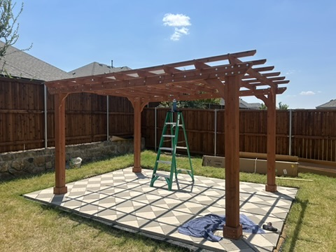
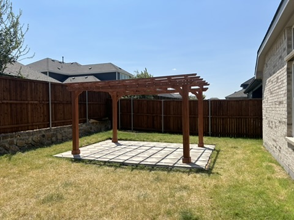
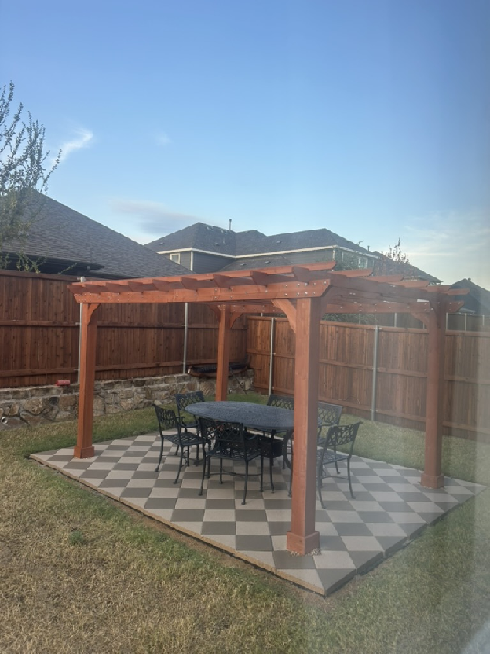

How in the world did I decide it was a good idea to DIY a pergola in my backyard? I’ll tell you how: Instagram Reels. Reels of people (probably professionals) paving patios and raising entire structures, all squeezed into a sub-minute montage. An hour of scrolling later, I had a full plan, an itemized supply list, and zero doubt that I could build a patio *and* a pergola myself. Then I started digging…

Keep in mind that this whole project took place smack in the middle of a Texas summer, when it hit a blistering 100 degrees by 10 a.m. every day. Did that stop me? No. No, it did not. So today I’m walking you through how I built my pergola, so you’ll know what not to do if you’re crazy enough to try it yourself.

**Step 1:** Don’t decide to build a pergola in the middle of a Texas summer.  
**Step 2:** Dig, dig, dig.

## Decide on the size

Ok, but in all seriousness, start by deciding the dimensions of the patio that you want to build your pergola on. A good guide is understanding what you want to put underneath the pergola. For me, I knew I wanted a six-person outdoor dining table, so a 12x14 ft pergola would be about the size I needed to comfortably fit the average-size dining table I wanted. With the size of the pergola determined, I added 1 ft on each side, making the whole patio 14x16 ft.

## The supply list

After I determined the size of the patio, I was able to create my sacred itemized list:

| Item | Where I got it | Cost |
|---|---|---:|
| 1 ton of sand | Local wholesale supplier (delivered) | $100 |
| 250 sq ft of pavers (12x12 in concrete patio stones in [gray](https://www.lowes.com/pd/Square-Gray-Concrete-Patio-Stone-Common-12-in-x-12-in-Actual-11-7-in-x-11-7-in/3048009) and [tan](https://www.lowes.com/pd/Square-Tan-Concrete-Patio-Stone-Common-12-in-x-12-in-Actual-11-7-in-x-11-7-in/3018985)) | Lowe’s | about $243 ($0.97 per sq ft) |
| The pergola (I bought a [12x14 ft cedar pergola kit](https://www.homedepot.com/p/VEIKOUS-12-ft-W-x-14-ft-D-Brown-Cedar-Wood-Patio-Pergola-Shade-Structure-for-Outdoor-PG0202-07-1/332759901)) | Home Depot | $918 |
| A bag of [pea pebble gravel](https://www.homedepot.com/s/pea%20pebbles) | Home Depot | about $6 |
| 4 bags of [Quikrete Fast-Setting Concrete Mix, 50 lb](https://www.homedepot.com/p/Quikrete-50-lb-Fast-Setting-Concrete-Mix-100450/100318521) | Home Depot | about $28 ($6.91 per bag) |
| A cylindrical mold for the concrete (I used four [Home Depot 5-gallon buckets](https://homedepot.com/p/The-Home-Depot-5-Gallon-Orange-Homer-Bucket-05GLHD2/100087613)) | Home Depot | about $20 ($4.98 per bucket) |
| [Paver base panels](https://www.amazon.com/s?k=brock+paverbase+paver+base+panels) (roughly 45 panels at $10–$11 each to cover 224 sq ft) | Amazon | about $450–$500 |
| [Mason’s line](https://www.homedepot.com/p/T-W-Evans-Cordage-1-x-500-ft-Braided-Nylon-Mason-in-Line-12-500/205326753) | Home Depot | about $9 |
| [Weed barrier](https://www.amazon.com/s?k=landscape+fabric+weed+barrier) + [staples](https://www.amazon.com/s?k=landscape+staples) | Amazon | $28.49 |
| A few hours of tilling | [Home Depot Tool Rental](https://www.homedepot.com/c/tool_and_truck_rental) | about $50–$80 (4-hour minimum) |
| [Hand tamper](https://www.homedepot.com/p/Ames-48-in-Handle-8-in-x-8-in-Steel-Tamper-2233400/204476033) | Home Depot | about $40–$50 |
| [Polymeric sand](https://www.homedepot.com/s/polymeric%20sand) | Home Depot (1 bag) | about $20–$40 |
| Experience and hard work | – | Priceless |

All in, that comes to roughly $2,000.

## Map out the patio

Now, drawing is going to be your best friend when it comes to deciding where to position your patio. You can redo your drawing a million times, but you can’t move the patio. Measure the space—your yard, the fence line, the house, or the distance from one tree to another. Just give yourself some kind of measurement to go off of in your drawing, preferably lengthwise and widthwise.

Next, I spray-painted an outline of the patio in the grass. This sounds easy. It’s not. And this is why we have the drawings as our practice. I thought I knew where I wanted to put my pergola on paper, but once I got out there, the positioning of my house’s window led me in a completely different direction. I ended up respraying the outline three different times. The trick here is to not change your mind. But similar to the drawings, the spray paint is meant to be impermanent.

## Till and dig

Now we are breaching more permanent territory. We start digging. If you live in Texas like I do, I would recommend renting a tiller and tilling the area (especially if you are doing an area as big as mine) before digging. It breaks up the hard soil and makes it a lot easier to dig. Luckily, I had my dad around with his truck to help me rent the tiller, and then he did the tilling himself.

I thought my dad was going to take his legs out with the tiller from Home Depot. That machine had a ton of unexpected power and was extremely dangerous. I recommend using it, but with extreme caution (or getting your dad to do it).

<figure>

<figcaption>The tilled patio area</figcaption>
</figure>

After we tilled the section, my dad and I spent about a week and a half digging. After about 10 a.m., it got too hot to dig, so from 7 a.m. to 10 a.m. each day, we were outside digging. I decided about three inches deep was good enough to add sand, paver base, and pavers on top and have it be flush with the grass. Luckily, this depth ended up working out (otherwise, we’d have needed to dig more). Afterward, I used a hand tamper to pack the ground down and level things out. Finally, I put the weed barrier down. Note: Make sure you have good gloves throughout this process. My gloves were about three sizes too big, so I was constantly dealing with blisters.

<figure>

<figcaption>Halfway through the dig</figcaption>
</figure>

<figure>

<figcaption>Dug out and leveled</figcaption>
</figure>

## Pour the concrete footings

Next, I needed to figure out the logistics of how I was going to anchor the pergola to the ground. This is a must, especially in Texas. I had two options: 1. bury the posts in a hole and fill it with concrete, or 2. create concrete footings and drill the posts into the concrete. I went with the latter. So even after I thought I was done digging, I had four more foot-deep holes to dig.

Now, you may imagine digging four holes would be easy, but these holes were going to be permanent, so I wanted to get them right the first time. The last thing I wanted was to dig these holes and later find out that they were positioned a few inches off from the pergola’s dimensions. As a result, my dad and I assembled the beginning of the pergola. We used this to accurately measure where the holes should be dug. (Note: I recommend having at least three people present to build the pergola and stand it up. Since there were only two of us, this was extremely difficult.)

All the Home Depots around us were out of the size of concrete form tubes that we needed, so we used Home Depot buckets instead, which worked out perfectly. To allow the concrete to form to the ground at the bottom of the hole and create a solid anchor, I cut out the bottoms of the buckets. This made them fairly similar to what a concrete form would look like. Afterward, I put the buckets into the holes and made sure each bucket was level with the others, using a piece of plywood long enough to span the holes. The leveling part of this step is extremely important if you want your pergola to not be crooked. Next, I used Quikrete to fill the holes. (This part was actually very satisfying. I highly recommend playing with concrete at some point in your life.)

<figure>

<figcaption>The bucket forms set in the ground, with the pergola kit laid out nearby</figcaption>
</figure>

## Sand and paver base

After endless digging, I thought things would get easier. They didn’t. Next up was sand. I bought the sand wholesale and had it delivered to the house. They dropped it off in my driveway, and I was able to shovel it into a wheelbarrow and take it out back. The problem with this step was the patience required to level a space as large as 14x16 ft. In the middle of the summer, you aren’t going to want to be bent over on your hands and knees, methodically leveling 4x4 ft sections of the space in the scorching hot sun. My problem at first was trying to do it all at once. Things got easier when I created sections and leveled each section one at a time. It was both mentally and physically painful. I was elated when it was complete.

Instead of buying a ton of rock and having to shovel it and level it, I opted for the easier solution—paver base panels. In ten years, I’ll let you know if this was a good idea or not. At the time, it worked out pretty nicely. They were easy to cut to fit the space using a box cutter. This step in the process actually ended up being pretty easy. I highly recommend paver base panels.

## Lay the pavers

Next, Lowe’s conveniently delivered the pavers and placed them inside my garage for me. My friend Sophia and I then hauled all 250 pavers from my garage to my backyard. After all the pavers were in the backyard, I started laying them. At first, I brute-forced laying the pavers in the design I wanted. Unfortunately, I wanted a design that actually needed some planning put behind it. I wanted straight diagonal lines. About halfway through, I was so proud of the work I had done—until I looked up reference pictures. I was completely off. Diagonals at all kinds of wrong angles. I had to completely restart. This time, I used a mason’s line to create starting lines throughout so that I wouldn’t have to start over a third time.

<figure>

<figcaption>Laying the pavers in a diamond pattern</figcaption>
</figure>

<figure>

<figcaption>The finished patio</figcaption>
</figure>

## Build the pergola

Finally, the patio was done! Next up was the pergola. Luckily, I had great friends who helped me. The pergola I bought was a kit from Home Depot, so with a lot of drilling, following instructions, and teamwork, the three of us got the job done.

<figure>

<figcaption>The pergola going up</figcaption>
</figure>

## Finishing touches

When I laid the pavers, I left a square gap around each pergola post so the concrete footings weren’t covered. For finishing touches, I added pebble gravel to the squares where the pergola was anchored to my concrete holes. I then added polymeric sand to the pavers to fill in any gaps.

<figure>

<figcaption>The finished pergola</figcaption>
</figure>

> Note: Throughout this whole process, I used delivery from the vendors so that I didn’t need a truck. The only time a truck was required was to rent the tiller. If you do need a truck, though, Home Depot has trucks you can rent.

## Was it worth it?

So, was it worth it? A week and a half of digging, more blisters than I can count, and three rounds of spray paint later, I have a patio and a pergola in my backyard that I built with my own two hands (plus a few extra hands). Now every time I sit under it at my six-person dining table, I forget all about those 100-degree mornings. Almost. Would I do it again? Yes. Would I do it again in the middle of the summer in Texas? No, no, I would not.

Before I go, I want to thank my dad and my two friends, Sophia and Dylan, for helping me in this process. While I was crazy enough to think I could do this all myself, looking back, I can’t imagine that being possible. They kept me company through the torture (digging, drilling, tilling), and my heart aches with how happy I was to have them helping me. You guys are the best.

<figure>

<figcaption>Dinner under the pergola</figcaption>
</figure>
